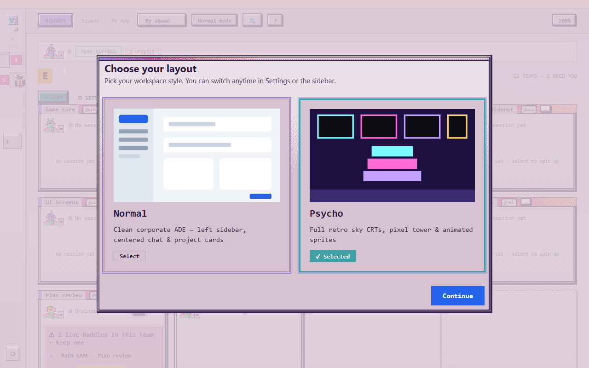

# Everybody can vibe

You do not need to know how to code to make software with AI agents. You need to know what you want and how to tell when it is right.

The agents know the how. Your job is to steer.

This guide follows the streams. Each step is one sitting. Read it, then try it on your own idea.

The guide is written for VibeSquad, the app where you chat with a Buddy and watch a Lead and its workers. Claude Code, Codex, Gemini and OpenCode are providers: the AI inside it. Use whichever you already pay for.

This is the home screen. Each product is a Squad in the left column, and each feature in it is a team.

> **Aub:** My first projects were a WoW add-on, fixing friends' PCs by having agents read their logs, and some Android apps. I knew basically nothing. Everything I got looked like a patchwork zombie: each feature worked on its own, but the way they worked together sucked. I'd bought into the "make me a game, make no mistakes" meme. What I learned is that it's all about iteration.

Next: [ROLO](../ROLO.md), then [Step 1](01-you-and-a-buddy.md).
