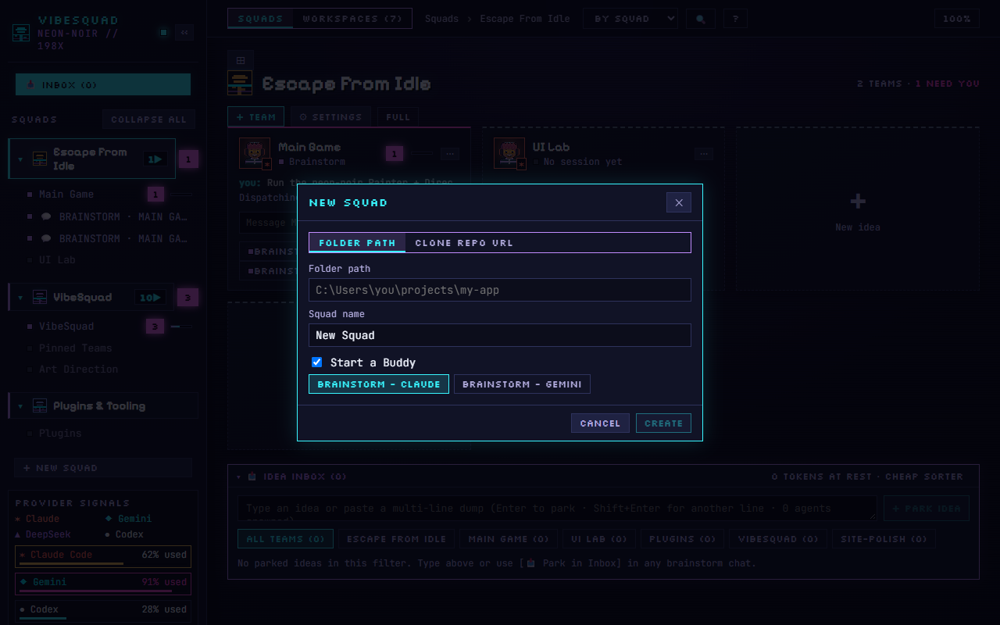
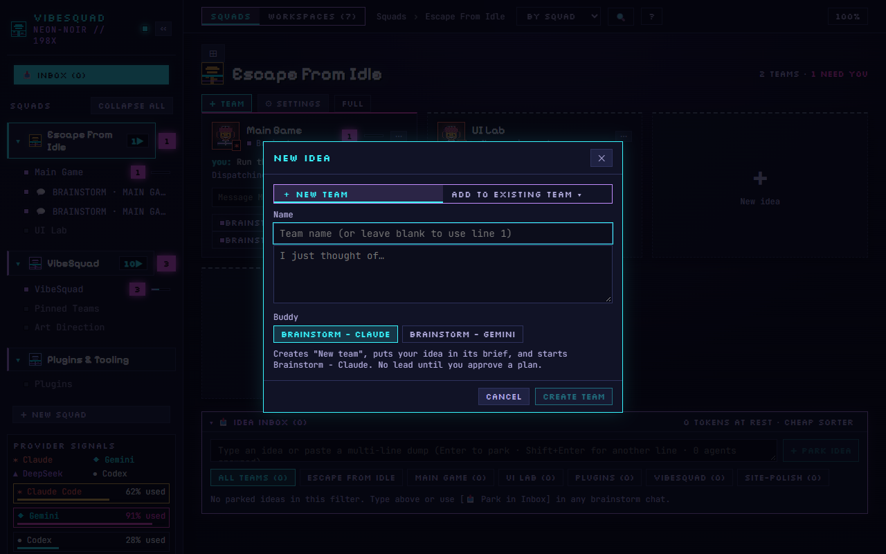

# Step 1: You and a Buddy

Goal: go from a loose idea to a [plain plan](../Concepts/Plain-Plan.md). You do not write code in this step.

This is the Riff part of [ROLO](../ROLO.md). Time: about 20 to 40 minutes.

## Before you start

- Your PC is set up. If not, do [START_HERE](../START_HERE.md) first.
- You have one idea you want to make. It can be vague.

## 1. Open a Buddy

A [Buddy](../Concepts/Buddy.md) is a chat for thinking.

In VibeSquad, click **+ New squad** at the bottom of the left column. A [Squad](../Concepts/Squads.md) is one product, and this window creates it.

Pick **Folder path** and type your project folder (or choose **Clone repo URL** to copy one from GitHub). Give it a **Squad name**. Leave **Start a Buddy** ticked, pick **BRAINSTORM - CLAUDE** or **BRAINSTORM - GEMINI**, and click **Create**. The Buddy's chat opens as "TALK HERE". Use a **new, empty project folder** for this. Leave the `guide` squad alone: it is only for the setup chat.

Already have a Squad and want a new feature? Click **+ TEAM** in the Squad's header, or the **New idea** card, and a fresh Buddy starts for it. Either way, type:

> Act as my Buddy. Ask me short questions and explain things in plain English. Do not write code yet. Keep a file called PLAN.md with what we decide.

You should see: it agrees and asks what you want to make.

## 2. Say what you want

Type it the way you would tell a friend. Include who it is for and what it should feel like. Do not worry about tech.

Example:

> I want a small game where you run a lemonade stand and the weather changes your sales. Something I can play in a browser in five minutes.

You should see: a few short questions back. Answer them. If you do not know, say "I don't know, what do you suggest?".

## 3. Think through how one works in plain language

This is the key move. Describe how you picture it working, in plain English. Type:

> I picture it like this: the player sets a price, customers come by faster or slower depending on the weather, and each sale adds to the money. Walk me through the pieces of how that works, and fill in the parts I'm leaving out.

You should see: the Buddy fills in the missing pieces in plain English and asks where it is not sure. Ask follow-ups until the parts make sense. For example: "Why does it need a save file?" or "What is the hard part?"

Now you know the how, because you and the Buddy worked it out together. Say which parts feel right and which do not.

## 4. Park side ideas

New ideas will show up mid-chat. Do not chase them. In VibeSquad, type the idea in the message box of the Brainstorm chat and click **📥 Park in Inbox** to send it to the Idea Inbox. You can also type it straight into the Idea Inbox at the bottom of the home screen and click **+ Park Idea**. Or type:

> Park that for later. Add it under "Not now" in PLAN.md.

You should see: the idea added to the file, and the chat goes back to the main idea.

## 5. Leave with a plain plan

Type:

> Write the plain plan in PLAN.md: what, why, done when, not now. Use my words.

Open PLAN.md and read it. If something is wrong, say what, and ask for a fix.

## Got a new idea that is not part of this one?

Click the **New idea** card on the Squad's home screen. The **New idea** window asks for a team name and "I just thought of…". Click **Create team** and that idea gets its own team and Buddy. Use **Add to existing team** to drop it into a team you already have. It says "No lead until you approve a plan", so nothing runs until you say so.

Keep one Buddy for one topic. See [Working with Squads](../Concepts/Squads.md).

## Done looks like

- `PLAN.md` exists and has four parts: **What**, **Why**, **Done when**, **Not now**.
- You can read each line and say "yes, that is what I mean".
- "Done when" is something you can check by looking, not a feeling.
- There is no code yet.

If you cannot say yes to every line, stay in the chat and keep refining. That is the Loop part of ROLO, and it starts here.

> **Aub:** I started out wanting to build my own orchestrator from scratch. I talked the pieces out with a Buddy in plain English until I understood how one works, and VibeSquad's runner grew out of that — the orchestration was originally built on Paseo by getpaseo. Thinking it through in plain language, piece by piece, saved me from building the whole thing myself.

## Next

Step 2: hand the plan to a [Lead](../Concepts/Lead.md). Back to [Start](../Maps/Start.md).
