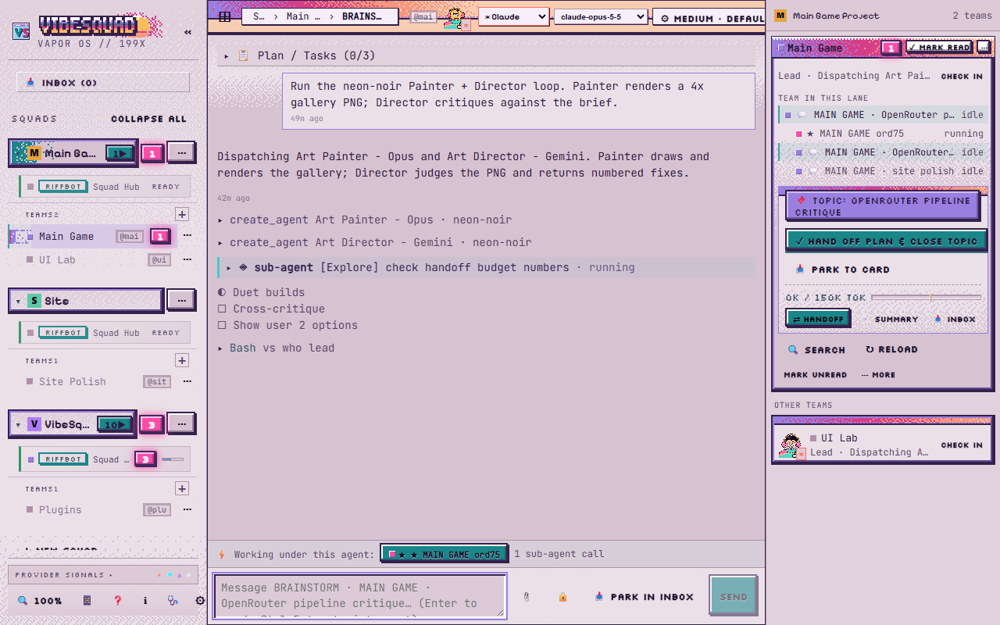
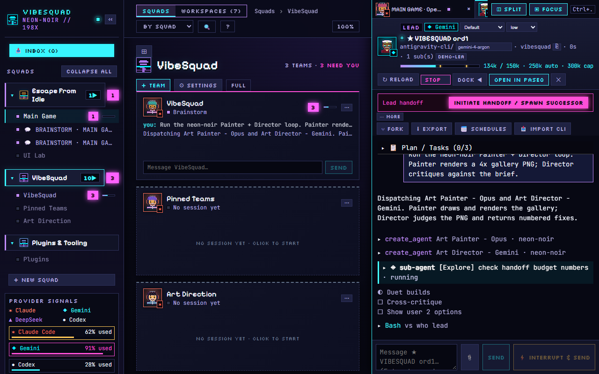

# Step 2: Lead and workers

Goal: hand your [plain plan](../Concepts/Plain-Plan.md) to a [Lead](../Concepts/Lead.md), and get small jobs done by [workers](../Concepts/Worker.md) with proof.

This is the Organize part of [ROLO](../ROLO.md). Time: one sitting, plus waiting for the jobs.

## Before you start

- You finished [Step 1](01-you-and-a-buddy.md) and have `PLAN.md` in your project folder.
- Your project is a git repo. If not, ask your Buddy: "run git init and make a first commit".

## 1. Put the rules in the project

Chat rules vanish between sessions. A file in the project is read every time.

Copy two files from this kit into your project folder:

- [AGENTS.md](../Setup/templates/AGENTS.md): rules for every agent.
- [LEAD_RULES.md](../Setup/templates/LEAD_RULES.md): rules only the Lead reads.

Easiest way: ask your Buddy (or any agent opened on your project folder) and type:

> Copy AGENTS.md and LEAD_RULES.md from the kit's Setup/templates folder into this project. Fill in the placeholders from PLAN.md. Ask me about any you cannot fill without guessing. Then add a CLAUDE.md that says "Read AGENTS.md" (only Claude Code needs it).

You should see: the two files appear, and a few questions about your project. Answer them.

Read the files once. You do not need to understand every line. You are checking that nothing says something you disagree with.

## 2. Start the Lead

The Lead is a second chat. Start it yourself: click **FULL** at the top right of the Squad page (the default page only shows Teams), then in the header click **+ NEW AGENT**, pick a Lead profile in **PROFILE** (role: lead), then click **Spawn agent**. Your Buddy can also start one for you through VibeSquad (no extra tool to install). The **✓ Handed off** button on the Buddy only marks the Buddy done; it does not start a Lead. When a Buddy has been working on one topic, **✓ Hand off plan & close topic** hands that topic's plan on and closes the chat.

 VibeSquad shows the Lead as "RUNS THE WORK" (in **FULL** view, or in the Team's rail on the default page). Open the Lead's chat and type:

> You are the Lead. Read AGENTS.md, then LEAD_RULES.md, then PLAN.md. Do not write code yourself. Split the plan into small jobs. For each job, give: what it is, what is out of scope, and what proof you expect. Show me the list and wait for my yes.

You should see: a numbered list of small jobs. Each has a goal, an out-of-scope line and an expected proof. If a job feels big, say "split job 3 in two".

## 3. Pick the cheapest model that can do each job

Ask:

> For each job, say which kind of model should do it: strongest, mid, or cheapest. Say why. Use the cheapest that can do it well.

You should see: most jobs on the cheaper tiers, and the strongest model only on the hard ones. See [Cheapest capable model](../Concepts/Cheapest-Capable-Model.md). If a choice looks odd, ask why.

## 4. Say yes, and let workers run

Type "yes, go" when the list looks right.

The Lead starts workers, one per job. Ask it to name each one by its job (see [Naming](../Concepts/Naming.md)). They show under the Lead in VibeSquad, one card per job.

You should see: workers starting, then finishing one by one.

## 5. Ask for proof, not prose

Every worker must end with a report: its commits, the raw `git diff --stat`, and raw test output. Say it to the Lead if it is not happening:

> Reject any report without raw output. Show me the proof lines for each finished job.

You should see, for each job, text like this:

```
STATUS: done
--- git diff --stat ---
 src/game.js | 42 +++++++++++++
 1 file changed, 42 insertions(+)
--- tests ---
12 passed, 0 failed
```

The format is in [REPORT_FORMAT.md](../Setup/templates/REPORT_FORMAT.md). A summary in the worker's own words is not proof. See [Proof, not prose](../Concepts/Proof-not-Prose.md).

> **Aub:** Honestly, I don't know, and you don't need to either. That's the point. I talked it through with the Buddy, and it worked out which rules made sense. VibeSquad ships good defaults so you don't have to start from nothing.

## Done looks like

- `AGENTS.md` and `LEAD_RULES.md` are in the project, with placeholders filled.
- The Lead made a job list that you approved.
- Each finished job has a report with raw output.
- You have not written or fixed any code yourself.

## Several features at once

Each feature is its own team with its own Buddy and Lead, so you can run them side by side. See [Working with Squads](../Concepts/Squads.md) for how to keep track of them.

## When the Lead needs you

A Lead that is stuck on a decision only you can make sets the `needs-you` flag on itself. In VibeSquad its card moves up. Answer it in the Lead's chat.

## Watch the Lead's context

A Lead that runs long gets slow and costly. When it is heavy, it should write a handoff and a fresh Lead takes over. VibeSquad shows the Lead's token count against its limits and offers **Initiate Handoff / Spawn Successor**. See [Handoff](../Concepts/Handoff.md).



## Next

[Step 3: back to you](03-back-to-you.md). Back to [Start](../Maps/Start.md).
