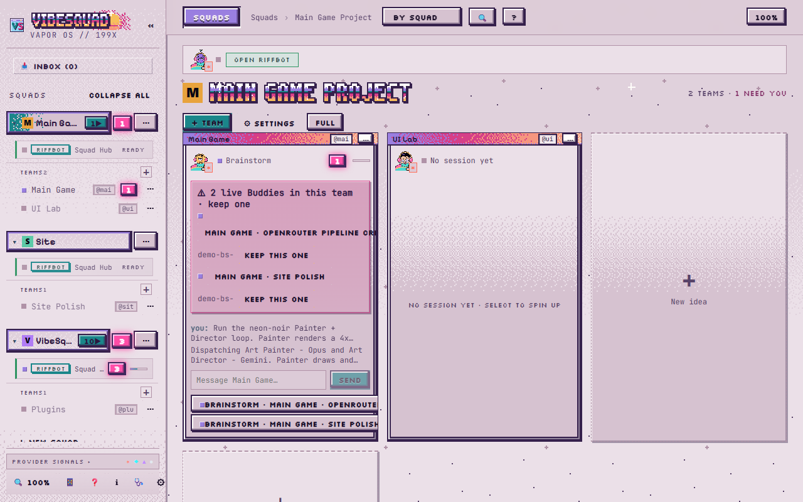

# Step 3: Back to you

Goal: decide what you keep. Look at the result, say what you see, and repeat until it is right.

This is the Own part of [ROLO](../ROLO.md). The Loop runs here too. Time: as many rounds as it takes.

## Before you start

- [Step 2](02-lead-and-workers.md) is done: finished jobs, each with a report.

## 1. Look at it yourself

Run the thing. Open the page, play the game, click the buttons. Do not read code.

Ask the Lead: "How do I run this? Give me the exact command." Then run it.

You should see: something on your screen. It will not be right yet. That is normal.

## 2. Say what you see

Write down what is wrong in plain words, as if telling a friend. Be specific about what you see and what you expected.

> The lemonade price box is hidden behind the weather icon. I expected it to sit under the stand. Also, clicking "sell" twice quickly gives me negative money.

Paste that to the Lead. Add a screenshot if you can.

You should see: the Lead turns it into small jobs, workers fix them, and proof comes back. Check the proof, then look again.

## 3. Repeat the loop

Look. Say what you see. Wait for the fix. Look again. Stop when the "Done when" in `PLAN.md` is true.

Each round should be small. If a round touches ten things, ask for it to be split.

## 4. Keep the calls that are yours

The agents build. You decide:

- **Design:** how it looks and feels. Never let a worker decide this for you.
- **Yes or no:** each change is yours to accept or send back.
- **Scope:** what is in, and what goes to "Not now".

If a worker or Lead asks a design question, it should stop and ask you, with options and a recommendation. In VibeSquad that shows as the `needs-you` flag on the Lead, and the Squad's header counts it under **NEED YOU**. Answer it, or say "you pick, but tell me why".

## 5. Have a different model review it

A model shares its own blind spots. Ask a model from a different family to check the work. See [Cross-family review](../Concepts/Cross-Family-Review.md).

> Review the last change as a skeptic. List problems with the file and line and the command that shows each one. Do not fix anything.

Run the same prompt in a chat on a different provider if you have one (you pick the provider when the chat starts, with **PROFILE** in **+ NEW AGENT**, **BRAINSTORM PROFILE** in **+ TEAM**, or the **Buddy** buttons in **+ New squad** and **New idea**; it cannot be changed mid-chat). If you do not, use a fresh chat on a different model tier and say so in the notes.

You should see: a list of findings with evidence. Send real ones back to the Lead. Ignore the rest.

## 6. Merge through a pull request

Work happens on a branch, never straight on `main`. When you say yes, it merges through a pull request (PR).

Ask the Lead:

> Open a pull request for this branch. Describe what changed in plain words.

You should see: a PR link on GitHub. Read the description, then open the PR's **Files changed** tab and look at what actually changed, and check the CI checks are green. The description is only the Lead's own summary. If the files match what you asked for and CI is green, say "merge it".

Who clicks merge depends on one setting. A **required check** is an automatic test that GitHub insists must pass before anything can merge. If your repo has one, the Lead can turn on auto-merge, and GitHub merges the PR by itself once CI is green. If it doesn't, the Lead opens the PR and stops, and you merge it yourself after checking **Files changed** and CI.

What I learned about this: [Cross-family review](../Concepts/Cross-Family-Review.md).

## 7. Finish the feature

Every team you create is pinned on its Squad's home screen, as a tile next to the **New idea** card, so you can click straight back into it. Nothing leaves the screen on its own. When a feature is really done, use **Mark complete** on its tile. Press it twice to confirm. The team moves to the **Done** list at the bottom of the page, its Brainstorm and Lead retire, and **Reopen** brings it back.

## Done looks like

- "Done when" in `PLAN.md` is true, and you checked it by looking.
- Every change was merged through a PR that you said yes to.
- Parked ideas are still in "Not now", not half-built.

## Next

[Step 4: what I learned](04-what-i-learned.md). Back to [Start](../Maps/Start.md).
