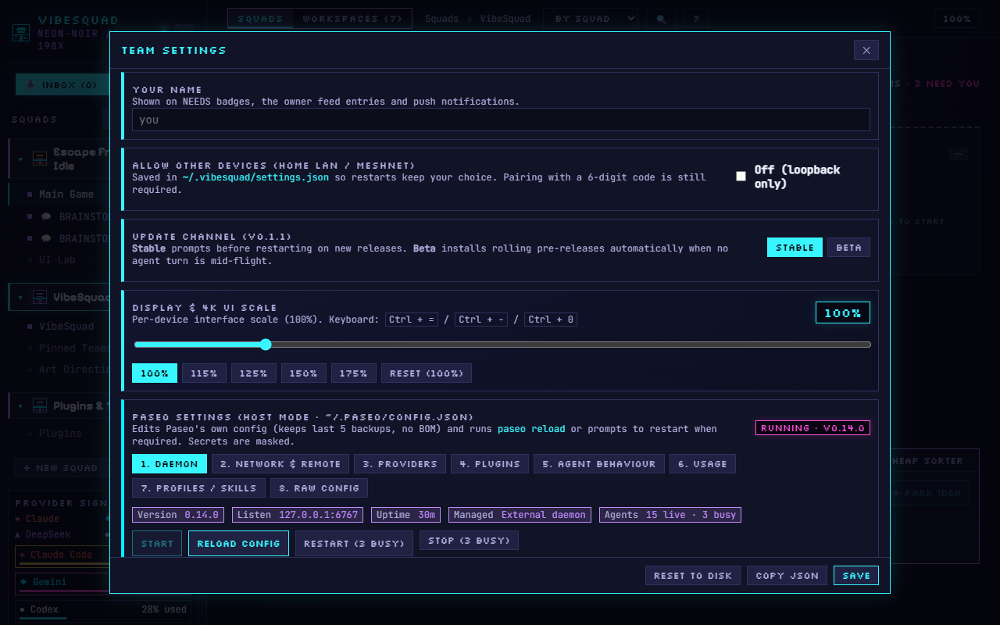
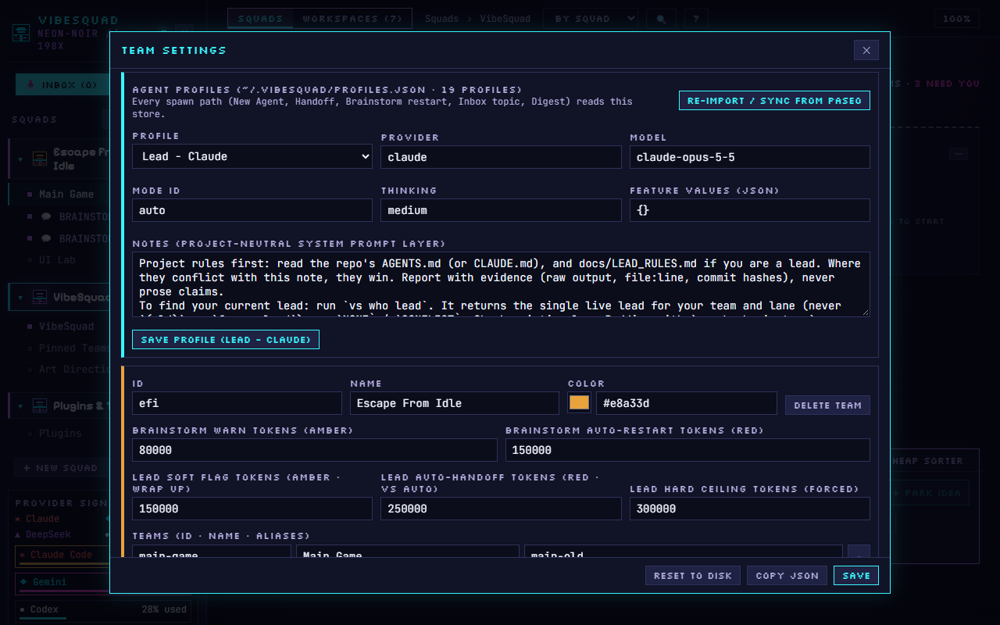
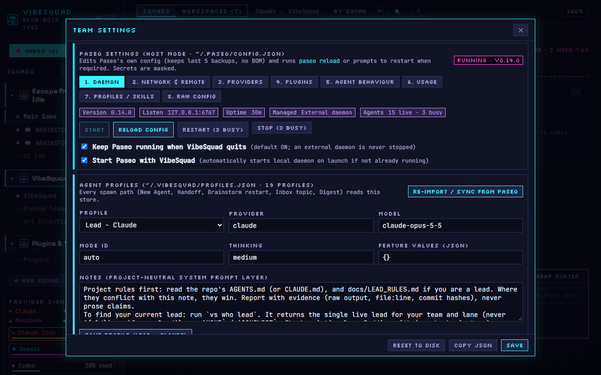

# Settings

What each area of VibeSquad's Settings window does, when to touch it, and the safe default. If a setting isn't listed here, you don't need it yet.

Open it from the **⚙ SETTINGS** button in a Squad's header in VibeSquad. The window is titled **TEAM SETTINGS**. Section names below are the labels you will see on screen. The top of the window holds the first four sections:

## Your name

The **YOUR NAME** box. This is the name VibeSquad shows on NEEDS badges, in the owner feed and in push notifications. It saves as you type (40 characters max).

- **Change it when:** you want the squad to address you by name instead of the placeholder `you`.
- **Safe default:** a first name or a nickname. Anything works.

## Display

**DISPLAY & 4K UI SCALE** makes the whole interface bigger or smaller, from 80% to 200%. It is per device, so your laptop and your phone can differ. Use the slider, one of the preset buttons, or **Reset (100%)**. The keyboard does the same thing: `Ctrl` + `=` bigger, `Ctrl` + `-` smaller, `Ctrl` + `0` back to normal.

- **Change it when:** text is tiny on a 4K screen, or you want more on screen at once.
- **Safe default:** 100%.

## LAN access

**ALLOW OTHER DEVICES (HOME LAN / MESHNET)** has one checkbox. It reads **Off (loopback only)** when only this PC can reach VibeSquad, and **Enabled** when other devices on your home network (or a meshnet like Tailscale) can too. When it is on, the section lists the addresses it is active on. Your choice is saved in `~/.vibesquad/settings.json`, so restarts keep it. Another device still has to pair with a 6-digit code.

- **Change it when:** you want to open VibeSquad from your phone or a second PC at home.
- **Safe default:** off. Turn it on only on a network you trust.

## Update channel

**UPDATE CHANNEL** shows your version and two buttons:

- **Stable**: new releases ask before VibeSquad restarts.
- **Beta**: rolling pre-releases install on their own, when no agent is in the middle of a turn.

- **Change it when:** you want the newest fixes early and can live with the odd rough edge. Switch back to Stable if it gets annoying.
- **Safe default:** Stable.

## Profiles

**AGENT PROFILES** is the list of ready-made agent setups. Every way of starting an agent (New Agent, Handoff, a Buddy restart, an Inbox topic, Digest) reads from it. Pick one in the **PROFILE** dropdown, edit it, then press **Save profile**. A profile marked "(install …)" needs its provider installed first.

The fields:

- **PROVIDER**: which tool runs the agent, for example Claude Code or Codex.
- **MODEL**: which model that provider uses. See [Cheapest capable model](../Concepts/Cheapest-Capable-Model.md).
- **MODE ID**: how freely the agent may act, for example `auto`, `accept-edits`, `build`, `plan` or `default`. Leave it empty for the provider's own default.
- **THINKING**: how hard the model thinks: `low`, `medium`, `high` or `default`. More thinking is slower and costs more.
- **FEATURE VALUES (JSON)**: extra provider options as JSON. Leave it alone unless a guide tells you what to put there.
- **NOTES (PROJECT-NEUTRAL SYSTEM PROMPT LAYER)**: standing instructions added to every agent that uses this profile. Keep them general, not about one project. If a note looks project-specific, a warning appears under the box.

**Re-import / Sync from Paseo** pulls profiles from Paseo's own config. A "Diff detected" hint appears when the two disagree.

- **Change it when:** you want a cheaper model for simple jobs, or a stricter mode for risky ones.
- **Safe default:** keep the profiles VibeSquad gave you and change one field at a time.

## Token thresholds (squad editor)

Below the profiles, each Squad has its own editor: ID, NAME, COLOR, then five token fields. They decide when VibeSquad warns you about a long chat and when it steps in. The defaults come from VibeSquad's source:

| Field | Default | What happens |
| --- | --- | --- |
| **BRAINSTORM WARN TOKENS (AMBER)** | 80000 | The Buddy's meter turns amber. A hint to wrap up. |
| **BRAINSTORM AUTO-RESTART TOKENS (RED)** | 150000 | The Buddy restarts from its summary. |
| **LEAD SOFT FLAG TOKENS (AMBER · WRAP UP)** | 150000 | The Lead gets a wrap-up flag. |
| **LEAD AUTO-HANDOFF TOKENS (RED · VS AUTO)** | 250000 | VibeSquad starts the handoff by itself. |
| **LEAD HARD CEILING TOKENS (FORCED)** | 300000 | Forced stop. |

These are looser than this kit's ladder: aim for 100k, be out by 150k, never past 200k. You can lower them to match, for example Buddy warn 80000 and auto-restart 150000, Lead soft flag 100000, auto-handoff 150000 and hard ceiling 200000. Change one field at a time and press **Save**. The reasons are in [Handoff](../Concepts/Handoff.md).

- **Change it when:** your Leads or Buddies get slow and vague before the default warnings appear.
- **Safe default:** the values above, until you have seen a handoff work.

## Config warnings

An amber **CONFIG JSON PARSE WARNING** box appears at the top only when a config file can't be read, usually because of a typo in the JSON. The box says which file and what went wrong. Nothing shows when all is well.

- **Change it when:** it appears. Fix the file it names, or restore a backup, then reopen Settings.
- **Safe default:** nothing to set. No box means no problem.

## Paseo

Paseo is the background program (the daemon) that actually runs your agents. **PASEO SETTINGS** edits its config and shows its status. A pill at the top says **RUNNING** with a version, or **STOPPED**. This section only appears when VibeSquad is the host, meaning the PC the daemon runs on.

The Daemon tab shows the version, the address it listens on, uptime, who manages it (VibeSquad-managed, External daemon or Stopped) and how many agents are live and busy. Its buttons:

- **Start**: starts the daemon. Greyed out while it runs.
- **Reload config**: re-reads the config without stopping anything.
- **Restart**: stops and starts it. If agents are busy the button shows how many and asks you to confirm, because it interrupts them.
- **Stop**: shuts it down, with the same busy check.

Two checkboxes:

- **Keep Paseo running when VibeSquad quits**: agents carry on after you close the window. On by default. A daemon VibeSquad didn't start is never stopped.
- **Start Paseo with VibeSquad**: starts the local daemon when VibeSquad launches, if it isn't already running.

- **Change it when:** an agent seems stuck (try Reload config, then Restart when nothing is busy), or you want the daemon to start and stop with the app.
- **Safe default:** leave both checkboxes as they are. Never press Stop or Restart while agents are busy unless you mean it.

### Network

The Network & Remote tab sets who can reach the daemon.

- **This PC only (127.0.0.1:6767)** or **LAN (…)**: pick the address, then **Save listen**. A change needs a restart, and a banner with **Restart daemon now** appears.
- **CORS ALLOWED ORIGINS**: web pages allowed to talk to the daemon. **+ Add origin** adds one.
- **PASEO RELAY**: encrypted remote access through Paseo's relay. Leave it as it is unless you want to reach your agents away from home.

Pair this with the LAN checkbox above. Leave all of it on its defaults unless you are setting up another device.
