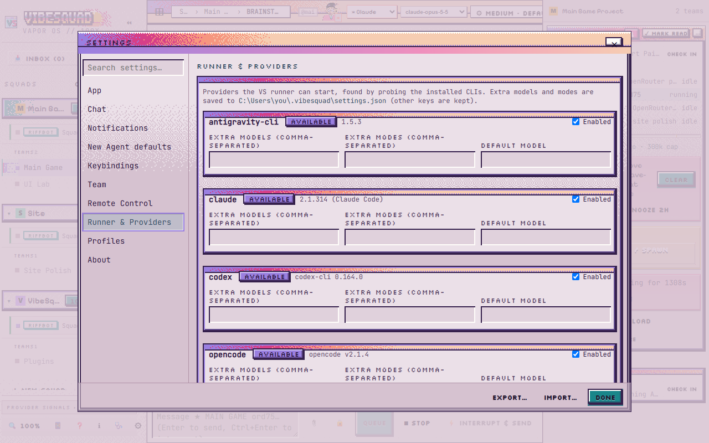

# Settings

What each area of VibeSquad's Settings window does, when to touch it, and the safe default. If a setting isn't listed here, you don't need it yet.

Open it from the **⚙ SETTINGS** button in a Squad's header in VibeSquad. It opens a **Settings** page with a list of tabs down the left (App, Chat, Notifications, New Agent defaults, Keybindings, Team, Remote Control, Runner & Providers, Profiles, About) and a search box. Section names below are the labels you will see on screen; if one is not where you expect, click through the tabs or search for it. Where things live: **YOUR NAME** and **ALLOW OTHER DEVICES** are on the **Team** tab (the **Remote Control** tab has the full pairing flow, below), **DISPLAY & 4K UI SCALE** is on **App**, and **UPDATE CHANNEL** is on **About**. The screenshot below is the **App** tab, which opens first.

## Your name

The **YOUR NAME** box. This is the name VibeSquad shows on NEEDS badges, in the owner feed and in push notifications. It saves as you type (40 characters max).

- **Change it when:** you want the squad to address you by name instead of the placeholder `you`.
- **Safe default:** a first name or a nickname. Anything works.

## Display

**DISPLAY & 4K UI SCALE** makes the whole interface bigger or smaller, from 80% to 200%. It is per device, so your laptop and your phone can differ. Use the slider, one of the preset buttons, or **Reset (100%)**. The keyboard does the same thing: `Ctrl` + `=` bigger, `Ctrl` + `-` smaller, `Ctrl` + `0` back to normal.

- **Change it when:** text is tiny on a 4K screen, or you want more on screen at once.
- **Safe default:** 100%.

## LAN access

**ALLOW OTHER DEVICES (HOME LAN / MESHNET)** has one checkbox. It reads **Off (loopback only)** when only this PC can reach VibeSquad, and **Enabled** when other devices on your home network (or a meshnet like Tailscale) can too. When it is on, the section lists the addresses it is active on. Your choice is saved in `~/.vibesquad/settings.json`, so restarts keep it. Another device still has to pair with a 6-digit code.

- **Change it when:** you want to open VibeSquad from your phone or a second PC at home.
- **Safe default:** off. Turn it on only on a network you trust.

## Update channel

On the **About** tab, **UPDATE CHANNEL** shows your version and two buttons:

- **Stable**: new releases ask before VibeSquad restarts.
- **Beta**: rolling pre-releases install on their own, when no agent is in the middle of a turn.

How you update on Stable: a bar across the top of the window says **Update available (v…) — restart?** with **Restart & Update** and **Later**. **Restart & Update** installs it and restarts VibeSquad. **Later** hides the bar for now. You can also open **About** and click **Check for updates** there. It shows **Checking…**, then **✓ Up to date (v…)**, or **⬇ Update to v…** when a newer version is found (click that to install). The first-launch and "Server Unreachable" screens have a **Check for Updates** button too. (Read from the v0.2.6 source, not run on a real update. On the Android app the same bar reads **Update available (v…) — download APK?** with a **Download Update** button, which opens the new APK download instead.)

- **Change it when:** you want the newest fixes early and can live with the odd rough edge. Switch back to Stable if it gets annoying.
- **Safe default:** Stable.

### Unstick VibeSquad and Restart runner

Both are on the **About** tab, on the host PC only (they don't show on a remotely connected device).

- **Unstick VibeSquad**: for when sends stall. It kills stray node processes (never VibeSquad's own server, the runner, MCP servers or live agents) and restarts the runner if it is down. It then reports how many it killed and whether the runner is healthy or DOWN (and "(restarted)" if it brought it back). If the runner isn't responding, it asks "Runner not responding — restart it? Running agents stop; Spin Up resumes them in place." and offers a **Restart runner** button.
- **Restart runner**: for when runner fixes aren't going live. It restarts the runner so the latest runner code loads. Pressing it asks first: "Restart runner? Running turns are cancelled; agents resume on next message." Choose **Restart now** or **Cancel**. Afterwards it says "Runner restarted" and how many turns it cancelled.

Restarts are now careful with your agents. When the `vs restart` command (or a runner restart on an update) runs, it waits for agents to go idle, and for any background work an idle agent started (like a test run), before it stops anything. If background work is still going after the wait, the restart is put off and nothing is stopped. Agents that were running are resumed afterwards and checked, with one retry; one that still won't wake is marked as an error instead of showing "initializing" forever. If the server itself restarted, an agent turn that finished while it was down is replayed once, so you still get the ping. The **Restart runner** button in Settings still cancels running turns, as its prompt says.

- **Change it when:** a send hangs (try **Unstick VibeSquad** first), or after an update the runner still behaves like the old version (**Restart runner**).
- **Safe default:** don't press either while an agent is mid-turn that you care about, since a restart cancels running turns.

## Profiles

**AGENT PROFILES** is the list of ready-made agent setups. Every way of starting an agent (New Agent, Handoff, a Buddy restart, an Inbox topic, Digest) reads from it. Pick one in the **PROFILE** dropdown, edit it, then press **Save profile**. A profile marked "(install …)" needs its provider installed first.

The fields:

- **PROVIDER**: which tool runs the agent, for example Claude Code or Codex.
- **MODEL**: which model that provider uses. See [Cheapest capable model](../Concepts/Cheapest-Capable-Model.md).
- **MODE ID**: how freely the agent may act, for example `auto`, `accept-edits`, `build`, `plan` or `default`. Leave it empty for the provider's own default.
- **THINKING**: how hard the model thinks: `low`, `medium`, `high` or `default`. More thinking is slower and costs more.
- **FEATURE VALUES (JSON)**: extra provider options as JSON. Leave it alone unless a guide tells you what to put there.
- **NOTES (PROJECT-NEUTRAL SYSTEM PROMPT LAYER)**: standing instructions added to every agent that uses this profile. Keep them general, not about one project. If a note looks project-specific, a warning appears under the box.

- **Change it when:** you want a cheaper model for simple jobs, or a stricter mode for risky ones.
- **Safe default:** keep the profiles VibeSquad gave you and change one field at a time.

## Token thresholds (squad editor)

On the **Team** tab, each Squad has its own editor: ID, NAME, COLOR, then five token fields. They decide when VibeSquad warns you about a long chat and when it steps in. The defaults come from VibeSquad's source:

| Field | Default | What happens |
| --- | --- | --- |
| **BRAINSTORM WARN TOKENS (AMBER)** | 80000 | The Buddy's meter turns amber. A hint to wrap up. |
| **BRAINSTORM AUTO-RESTART TOKENS (RED)** | 150000 | The Buddy restarts from its summary. |
| **LEAD SOFT FLAG TOKENS (AMBER · WRAP UP)** | 150000 | The Lead gets a wrap-up flag. |
| **LEAD AUTO-HANDOFF TOKENS (RED · VS AUTO)** | 250000 | VibeSquad starts the handoff by itself. |
| **LEAD HARD CEILING TOKENS (FORCED)** | 300000 | Forced stop. |

These are looser than this kit's ladder: aim for 100k, be out by 150k, never past 200k. You can lower them to match, for example Buddy warn 80000 and auto-restart 150000, Lead soft flag 100000, auto-handoff 150000 and hard ceiling 200000. Change one field at a time and press **Save**. The reasons are in [Handoff](../Concepts/Handoff.md).

- **Change it when:** your Leads or Buddies get slow and vague before the default warnings appear.
- **Safe default:** the values above, until you have seen a handoff work.

## Config warnings

An amber **⚠ CONFIG WARNING** box appears at the top only when a config file can't be read, usually because of a typo in the JSON. The box says which file and what went wrong. Nothing shows when all is well.

- **Change it when:** it appears. Fix the file it names, or restore a backup, then reopen Settings. It appears on the **Team** tab (read from the source; UNVERIFIED on a real broken config).
- **Safe default:** nothing to set. No box means no problem.

## Runner & Providers

The runner is the background program that actually runs your agents. This tab lists the providers it can start (Claude Code, Codex and so on). VibeSquad finds them by probing the command-line tools installed on this PC. Each provider has a status pill, its version when known, and an **Enabled** checkbox. Three fields let you add to what the pickers offer:

- **EXTRA MODELS (comma-separated)**: model names to add to the list.
- **EXTRA MODES (comma-separated)**: modes to add to the list.
- **DEFAULT MODEL**: the model used when none is chosen.

**Save runner settings** writes these to `~/.vibesquad/settings.json` and keeps every other key there. **Reload** re-reads them. Below that, **RUNNER USAGE** totals agent logs, turns and cost, with a chip per model and per lane. This tab only shows on the host PC. On a device connected remotely it is hidden, and runner settings live on the host.

- **Change it when:** a provider you installed isn't offered, or you want a model that isn't in the list.
- **Safe default:** leave everything as found. Untick **Enabled** only for a provider you never want offered.

## Remote Control

The **Remote Control** tab lets paired phones, tablets and laptops open VibeSquad over your home network or a meshnet VPN. It has three parts:

- **REMOTE CONTROL & REMOTE ACCESS**: the master switch, **Enabled** or **Off**. If a device reports that remote access is off on the PC, this is the one to turn on.
- **DIRECT HOME LAN / NORDVPN MESHNET**: **Enabled** or **Off (loopback only)**. When on, VibeSquad serves HTTPS on port 4180 to your home network or meshnet and lists the addresses it is active on.
- **LINK / PAIR A DEVICE**: the button **📱 Link / Pair a Device (QR & 6-Digit Code)** opens a window with a QR code and a 6-digit pairing code that expires after a short time. Scan the QR or type the code on the other device, and generate a new one when it expires. The window also shows the server addresses to type into the other device. A phone or browser may first need a one-time certificate step, which the same window explains.

The window scrolls, so on a small screen you can reach everything; the header and **Close** stay put. From top to bottom it shows:

1. **ANDROID APP (SIDELOAD APK)**: **⬇ Download VibeSquad.apk (Android)** and **Copy APK URL**, when the app is available. Install it, then use the app's own scan (not the phone camera).
2. **PHONE: SCAN QR TO PAIR**: the QR code, the countdown, and the 6-digit code.
3. The certificate step and the **CA SHA-256 FINGERPRINT**.
4. The desktop block (server addresses to type into another PC).
5. **PAIRED DEVICES**: every phone or PC that has paired, with when it was last seen.

**Pairing on the phone.** In the Android app, **Pair with your PC** has a **Scan QR code** button. Scanning fills in the address, the code and the fingerprint; you then press **Pair** after checking the address is your PC. If you type things in by hand instead, you also have to type the **CA fingerprint** (the first 8 pairs of characters at least).

**Checking the fingerprint.** The window shows a short fingerprint under **CA SHA-256 FINGERPRINT** (**Full hex** shows all of it). It identifies your PC's private certificate. When you install the certificate on a phone, compare the fingerprint the phone shows with the one on your PC screen. If the first characters match, it's your PC's certificate. If they don't, stop and don't install it. Never post or screenshot a real fingerprint.

**Revoking a device.** If a phone is lost or you no longer trust it, open **PAIRED DEVICES** and press **Revoke** next to its name. That device is signed out right away, including any live connection it had open, and has to pair again with a new code to come back. **↻ Refresh** reloads the list.

Pairing is always required, even with the network switch on. Treat the code like a password: don't post it, or a screenshot of it, anywhere.

- **Change it when:** you want to use VibeSquad from your phone or a second PC.
- **Safe default:** off. Turn it on only on a network you trust.
