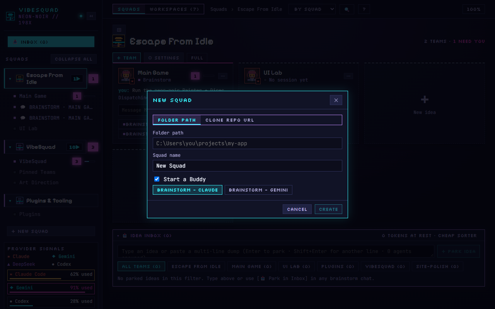

# VibeSquad (the one-stop installer)

## When you want this
This is where you work. VibeSquad is the app where you talk to your Buddy, start a Lead and watch the workers.
It does not run agents itself: the Paseo daemon does that, and Claude Code, Codex, Gemini and OpenCode are providers
that plug into it (see `providers/`). The installer brings its own Node.js and server, so you do not install Node,
Paseo or anything from source yourself.

If you are reading this inside VibeSquad, you already did this step: just run Verify.

## Install (Windows)
Install your provider and log in **before** you run the installer (`providers/`): Claude plan → `claude-code`, ChatGPT
plan → `codex`, Google licence or key → `core/node` then `gemini`, no subscription → `core/node` then `opencode`. The
installer's own `runtime\node.exe` is private and not on PATH, so it does not replace `core/node`. The Setup Checklist
below looks for Claude Code or Gemini on this PC when it opens.

1. Download `VibeSquad-setup.exe` from the latest release:
   https://github.com/Pizzarar/VibeSquad/releases/latest
   Only download it from that page. Do not use any other "VibeSquad" installer.
2. Run `VibeSquad-setup.exe`. It installs for your user account only (`installMode: currentUser`,
   `src-tauri/tauri.conf.json:48`), so it should not need administrator rights (UNVERIFIED: not run). If Windows shows
   a "protected your PC" screen, UNVERIFIED: whether this release is signed. Check with the person before they click
   through, and make sure the file came from the page above.
3. Open VibeSquad. On a clean machine it first asks "How will you use VibeSquad on this PC?" Choose
   **💻 Run agents on this PC** (`src-tauri/src/ui_pages.rs:185`; shown first when no mode is saved,
   `src-tauri/src/main.rs:2150`). Do not choose "Connect to another PC". Then the **Setup Checklist** can show
   (`src/FirstRunModal.tsx:140`); follow it (see "First run" below). UNVERIFIED: how this looks on a real machine.

What the installer puts on the PC (read from the source, not from a run):
- The app, with a private `runtime\` folder inside the install folder: its own Node.js, the VibeSquad server and the
  `vs` command (`src-tauri/tauri.conf.json:37`, `src-tauri/src/main.rs:1959`, `src-tauri/nsis/installer-hooks.nsh:19`).
  If that folder is missing, the app also looks in `%LOCALAPPDATA%\com.vibesquad.desktop\runtime\`
  (`src-tauri/src/main.rs:1964`). UNVERIFIED: the exact install folder path on a real machine.
- A `vs` command: the installer writes `vs.cmd` and `vs.ps1` into `%APPDATA%\npm` (`installer-hooks.nsh:15-16`). The
  README says `vs` works from any terminal, but on a clean PC with no Node that folder may not be on PATH
  (UNVERIFIED).
- If you have no Paseo, the first launch downloads Paseo `0.14.0` (about 500 MB, needs internet) into
  `%LOCALAPPDATA%\com.vibesquad.desktop\paseo` (`server/first-run.mjs:20`, `:372`). If you already have Paseo, or a Paseo
  daemon is already listening, VibeSquad reuses it and never starts a second one (`server/first-run.mjs:358-364`).
- Quitting VibeSquad stops the server it started (VibeSquad README).

## macOS line
`macOS: not supported by the one-stop installer` (UNVERIFIED: it looks Windows only. The from-source route in
`advanced/vibesquad-from-source.md` is untested on a Mac.)

## Verify
Run the PATH refresh first (see `START_HERE.md`, "PATH refresh").
**Main check (human):** the VibeSquad window is open and the **Setup Checklist** shows a tick on **1. Paseo CLI & Daemon**
(or, if the checklist was closed, you can read this chat inside VibeSquad). The person says "done".

**Optional extra check**, only if `vs` is found:
```powershell
vs --help
```
Expected: the `vs` command prints its usage text without an error (`cli/vs.mjs:2295` handles `--help`). If it says
"not found", that is not a failure: UNVERIFIED whether `%APPDATA%\npm` is on PATH on a clean PC. Skip it.

## First run (the human's steps)
1. Open VibeSquad. The **Setup Checklist** opens by itself until Paseo and a provider are ready, or until it has been
   closed once (`src/App.tsx:1489`). Its rows, exactly as the app writes them (`src/FirstRunModal.tsx`):
   - **1. Paseo CLI & Daemon** (`:158`): a tick with "found existing" or "bundled/managed" and a version once ready. With no
     Paseo it installs one and shows progress. Offline, it shows an error and a **Retry** button.
   - **Claude Code** (`:227`): "Installed", then "Logged in" or "Run 'claude' once to log in". If missing, a link to
     the installer.
   - **Gemini / Antigravity** (`:236`): "Installed", plus "Logged in" when it finds a login. If missing, a link to the
     installer.
   - **Git (optional)** (`:245`): "Installed" with a version, or an optional link.

   Buttons: **Check again** (`:145`) and **Continue** (`:147`).
2. **Continue** stays grey until Paseo is ready **and** Claude Code or Gemini is detected (`:132`). The checklist does
   not list Codex or OpenCode. If your provider is one of those, close the checklist with its close button: closing it
   also marks it done (`:141`). UNVERIFIED: how this looks on a real machine, and that Codex or OpenCode then work in
   the app. The provider module says how to check.
3. If you installed your provider after the checklist opened, **Check again** refreshes it. Sign in with **your own**
   account. Never reuse someone else's login.
4. Add your project. In VibeSquad, click **+ New squad** at the bottom of the left column (`src/App.tsx:398`). In the
   **NEW SQUAD** window (`src/NewSquadModal.tsx`) leave **Folder path** selected, type this folder, check the
   **Squad name**, leave **Start a Buddy** ticked and pick **BRAINSTORM - CLAUDE** or **BRAINSTORM - GEMINI**, then
   click **Create**.

   

   If your provider is not Claude Code or Gemini, also set up a profile for it under **AGENT PROFILES** in
   **⚙ SETTINGS** (the provider page says how; see [Settings](../../../Reference/Settings.md)).
5. In the Buddy's chat ("TALK HERE"), type: **read START_HERE.md**. To start another feature later, click **+ TEAM**
   in the Squad's header or the **New idea** card. Squads and teams are explained in
   [Working with Squads](../../../Concepts/Squads.md).
6. Official docs for the daemon: UNVERIFIED (no page was fetched for this module).

## Name agents with labels, from day one
VibeSquad sets labels for the agents it starts. If you start agents by hand with `paseo`, give each one labels when
you create it, not later: `lane` (the feature), `role` (`brainstorm`, `lead` or `worker`), plus `ord=N` for a Lead and
`job` for a worker. For example:
```powershell
paseo agent update <agent-id> --label lane=hello --label role=worker --label job=tests
```
(UNVERIFIED: the installer-managed Paseo may not put a `paseo` command on PATH. Most people never need this by hand.)
Labels are the source of truth; the agent's title is built from them. The full naming scheme is VibeSquad's
[`docs/NAMING.md`](https://github.com/Pizzarar/VibeSquad/blob/HEAD/docs/NAMING.md). It is still changing, so it
is linked here, not copied.

## Gotchas
- Do not run VibeSquad from source on a normal setup. That route is for people who want to change VibeSquad itself:
  `advanced/vibesquad-from-source.md`.
- VibeSquad listens on `127.0.0.1` (this computer only) by default. Do not open it to your network or connect to other people's machines or daemons.
- If the window says "Server Unreachable" it retries every 3 seconds (`src-tauri/src/ui_pages.rs:1214`); the local server
  uses port `4180` (`:1145`). Do not point it at anyone else's server.
- For any npm command a provider module asks for, use `npm.cmd`, not `npm` (see `core/node.md`).
