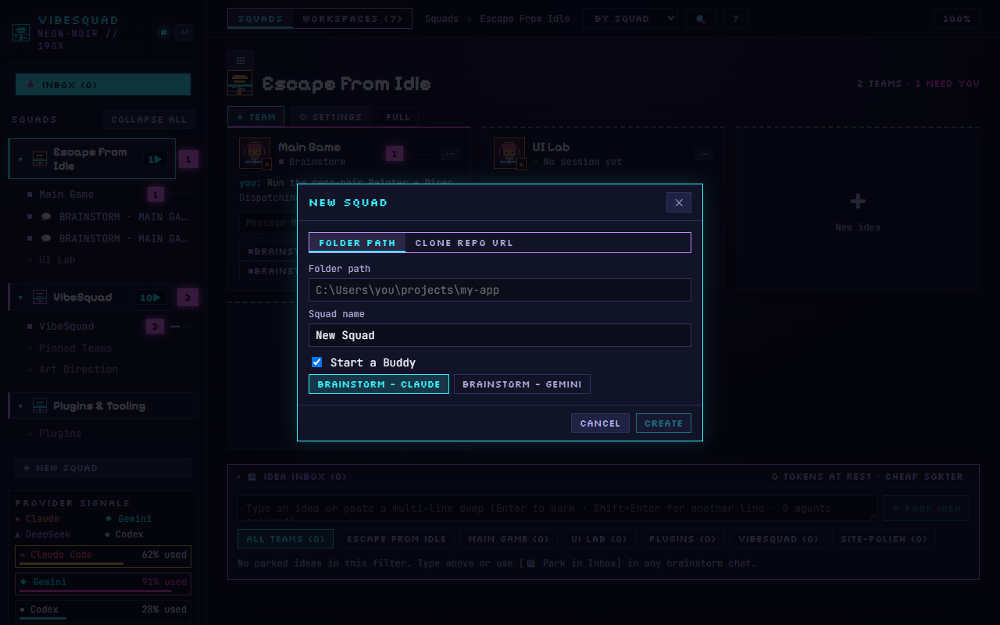

# VibeSquad (the one-stop installer)

## When you want this
This is where you work. VibeSquad is the app where you talk to your Buddy, start a Lead and watch the workers.
It runs agents with its own built-in runner (no Paseo daemon and no Paseo CLI), and Claude Code, Codex, Gemini and
OpenCode are providers that plug into it (see `providers/`). The installer brings its own Node.js and server, so you do
not install Node, a daemon or anything from source yourself. (VibeSquad was originally built on Paseo by getpaseo.)

If you are reading this inside VibeSquad, you already did this step: just run Verify.

## Install (Windows)
Install your provider and log in **before** you run the installer (`providers/`): Claude plan → `claude-code`, ChatGPT
plan → `codex`, Google licence or key → `core/node` then `gemini`, no subscription → `core/node` then `opencode`. The
installer's own `runtime\node.exe` is private and not on PATH, so it does not replace `core/node`. The Setup Checklist
below looks for Claude Code or Gemini on this PC when it opens.

1. Download `VibeSquad-setup.exe` from the latest release:
   https://github.com/Pizzarar/VibeSquad/releases/latest
   Only download it from that page. Do not use any other "VibeSquad" installer.
2. Run `VibeSquad-setup.exe`. It installs for your user account only (`installMode: currentUser`,
   `src-tauri/tauri.conf.json:48`), so no administrator prompt is expected (needs a clean-PC confirmation). v0.3.0 is
   updater-signed with minisign but has no Windows Authenticode signature (`docs/releases/vibesquad-0.3.0.md:14`), so
   Windows SmartScreen can show "Windows protected your PC". Check with the person before they click **More info**,
   then **Run anyway**, and make sure the file came from the page above. (Exactly how SmartScreen looks needs a
   clean-PC confirmation.)
3. Open VibeSquad. On a clean machine it first asks "How will you use VibeSquad on this PC?" Choose
   **💻 Run agents on this PC** (`src-tauri/src/ui_pages.rs:177,185`; shown first while no mode is saved,
   `src-tauri/src/main.rs:2351-2360`). Do not choose "Connect to another PC". Then the **Setup Checklist** can show; follow it
   (see "First run" below). How this looks on a real machine needs a clean-PC confirmation.

What the installer puts on the PC (read from the source, not from a run):
- The app, with a private `runtime\` folder inside the install folder: its own Node.js, the VibeSquad server and the
  `vs` command (`src-tauri/tauri.conf.json:37`, `src-tauri/nsis/installer-hooks.nsh:15-52`). The app looks for
  `runtime\` next to its exe, then in `%LOCALAPPDATA%\com.vibesquad.desktop\runtime\` and
  `%LOCALAPPDATA%\VibeSquad\runtime\` (`find_bundled_runtime`, `src-tauri/src/main.rs:1977-1997`). The exact install
  folder on a real machine needs a clean-PC confirmation.
- A `vs` command: the installer writes `vs.cmd` and `vs.ps1` into `%APPDATA%\npm` (`installer-hooks.nsh:15-52`) and
  does not edit `PATH`. If Node.js is installed that folder is normally already on PATH. On a PC without Node, add
  `%APPDATA%\npm` to your user PATH (Settings, search "environment variables", **Edit environment variables for your
  account**, **Path**, **New**), or run `%APPDATA%\npm\vs.cmd` directly.
- No daemon and no big download: the server starts the built-in runner itself (`server/runner-supervisor.mjs`) and
  restarts it if it stops. The Setup Checklist only looks for providers and Git (`src/FirstRunModal.tsx:228-254`).
- Quitting VibeSquad stops the server it started (`stop_managed_server`, `src-tauri/src/main.rs:2171-2179`).

## macOS line
`macOS: not supported by the one-stop installer` (UNVERIFIED: it looks Windows only. The from-source route in
`advanced/vibesquad-from-source.md` is untested on a Mac.)

## Verify
Run the PATH refresh first (see `START_HERE.md`, "PATH refresh").
**Main check (human):** the VibeSquad window is open and the **Setup Checklist** shows a tick on **Claude Code** or
**Gemini / Antigravity** (or, if the checklist was closed, you can read this chat inside VibeSquad). The person says "done".

**Optional extra check**, only if `vs` is found:
```powershell
vs --help
```
Expected: the `vs` command prints its usage text without an error (`cli/vs.mjs:3079` handles `--help`). If it says
"not found", that is not a failure: on a PC without Node, `%APPDATA%\npm` is not on PATH until you add it (see above).
Skip it, or run `%APPDATA%\npm\vs.cmd --help`.

## First run (the human's steps)
1. Open VibeSquad. The **Setup Checklist** opens by itself until a provider is ready, or until it has been
   closed once (`src/App.tsx:1545`). The component is `FirstRunModal` (`src/FirstRunModal.tsx:186-260`). Its rows,
   exactly as the app writes them:
   - **Claude Code** (`:228`): "Installed", then "Logged in" or "Run 'claude' once to log in". If missing, a link to
     the installer.
   - **Gemini / Antigravity** (`:237`): "Installed", plus "Logged in" when it finds a login. If missing, a link to the
     installer.
   - **Git (optional)** (`:246`): "Installed" with a version, or an optional link.

   Buttons: **Check again** (`:213-215`) and **Continue** (`:216`).

   VibeSquad opens in **Normal**; the old pixel-art **Psycho** layout is a legacy toggle in Settings > About
   (see [Normal and Psycho](../../../Concepts/Modes.md)).
2. **Continue** stays grey until Claude Code or Gemini is detected (`canContinue`, `:199`). The checklist does
   not list Codex or OpenCode. If your provider is one of those, close the checklist with **✕**: closing it
   also marks it done (`FIRST_RUN_DONE_KEY`, `:210`). Then pick your provider under **⚙ SETTINGS**, **Profiles**.
   Whether Codex or OpenCode then work in the app needs a clean-PC confirmation. The provider module says how to check.
3. If you installed your provider after the checklist opened, **Check again** refreshes it. Sign in with **your own**
   account. Never reuse someone else's login.
4. Add your project. In VibeSquad, click **+ New squad** at the bottom of the left column (`src/App.tsx:436`). In the
   **NEW SQUAD** window (`src/NewSquadModal.tsx`) type this folder in **Folder path**, check the
   **Squad name**, leave **Start a Buddy** ticked and pick **BRAINSTORM - CLAUDE** or **BRAINSTORM - GEMINI**, then
   click **Create**.

   

   If your provider is not Claude Code or Gemini, also set up a profile for it under **AGENT PROFILES** in
   **⚙ SETTINGS** (the provider page says how; see [Settings](../../../Reference/Settings.md)).
5. In the Buddy's chat ("TALK HERE"), type: **read START_HERE.md**. To start another feature later, click **+ TEAM**
   in the Squad's header or the **New idea** card. Squads and teams are explained in
   [Working with Squads](../../../Concepts/Squads.md).
6. Later, to update VibeSquad: when a **Restart & Update** bar appears at the top, click it (or **Later**). You can also
   check by hand in **⚙ SETTINGS**, **About** tab. Details: [Settings](../../../Reference/Settings.md), "Update channel".
   (Read from the source; UNVERIFIED on a real update.)
   **Restart & Update** installs and restarts straight away, so finish or pause running agents first. Other restarts are gentler; see [Settings](../../../Reference/Settings.md), "Unstick VibeSquad and Restart runner".

## Name agents with labels, from day one
VibeSquad sets labels for the agents it starts. If you start agents by hand, give each one labels when
you create it, not later: `lane` (the feature), `role` (`brainstorm`, `lead` or `worker`), plus `ord=N` for a Lead and
`job` for a worker. For example:
Most people never need this by hand: your Buddy starts the Lead through VibeSquad, and the Lead starts workers with
`vs spawn --title "<t>" --profile "<profile>" --prompt "<text>"` (from `vs --help`), which sets the labels for you. For a long brief use `--prompt-file <path>` (or `--prompt-file -` for stdin) instead of `--prompt "<text>"`; the same goes for `vs send <agent> --prompt-file <path>`.
**v0.3.0 breaking rule (`VS_AGENT_TOKEN`).** The runner puts an in-memory `VS_AGENT_TOKEN` into every agent it starts
(`docs/releases/vibesquad-0.3.0.md:16-21`, `SECURITY.md:12`). A hand-run script or shell that passes `VS_AGENT_ID`
without a runner-issued `VS_AGENT_TOKEN` gets 403, and a leftover token with the id cleared is not treated as the
owner either. So run manual `vs` commands as the owner (with both `VS_AGENT_ID` and `VS_AGENT_TOKEN` unset), or start
agents through VibeSquad or `vs spawn`, which inject the token.
Labels are the source of truth; the agent's title is built from them. The full naming scheme is VibeSquad's
[`docs/NAMING.md`](https://github.com/Pizzarar/VibeSquad/blob/HEAD/docs/NAMING.md). It is still changing, so it
is linked here, not copied.

## Gotchas
- Do not run VibeSquad from source on a normal setup. That route is for people who want to change VibeSquad itself:
  `advanced/vibesquad-from-source.md`.
- VibeSquad listens on `127.0.0.1` (this computer only) by default. Do not open it to your network or connect to other people's machines or daemons.
- If the window says "Server Unreachable" it retries every 3 seconds (`src-tauri/src/ui_pages.rs:1065,1068`); the local server
  uses port `4180` (`:189`). Do not point it at anyone else's server.
- For any npm command a provider module asks for, use `npm.cmd`, not `npm` (see `core/node.md`).
